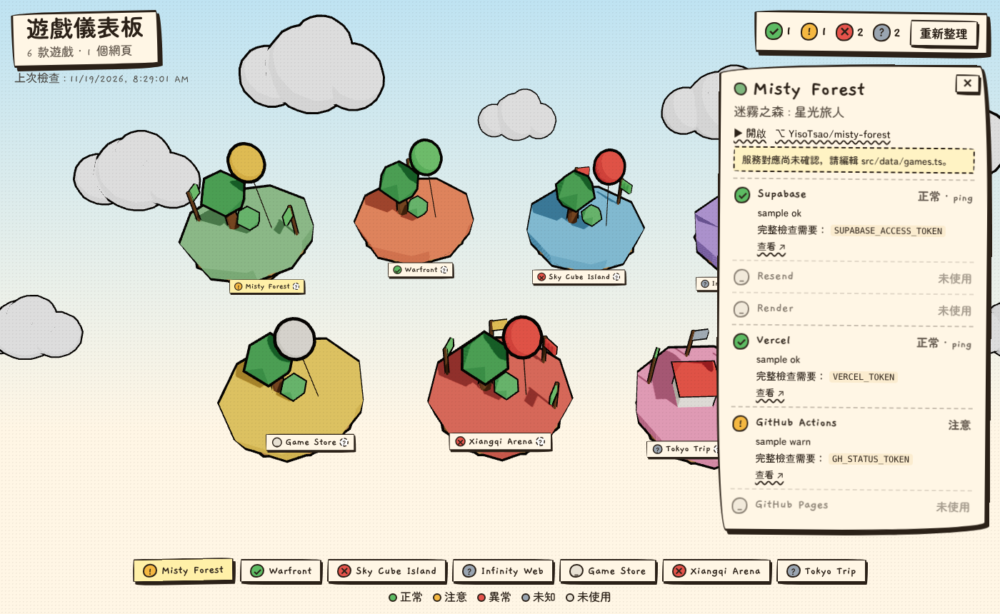

# Game Dashboard



A cartoon 3D dashboard (React Three Fiber + Three.js + TypeScript) that lists Yiso's games and shows whether the services each one uses are working: Supabase, Resend, Render, Vercel, GitHub Actions and GitHub Pages.


## Run it

```bash
npm install
cp .env.example .env   # fill in the keys you have
npm run status         # checks every service, writes public/status.json
npm run dev            # http://localhost:5173
```

Other scripts: `npm test` (unit tests for the checks), `npm run build`, `npm run typecheck`.

## How it works

```
src/data/games.ts      the game list and which services each game uses  <- edit this
scripts/check-status.ts runs the checks in Node, writes public/status.json
src/status/checks.ts   one check per service
src/scene/             the 3D islands (R3F)
src/ui/                HTML panel
.github/workflows/status.yml  runs the check every 30 min and deploys to GitHub Pages
```

API keys are only read by the Node script (locally from `.env`, in CI from GitHub secrets). The web page only reads the finished `status.json`, so keys never reach the browser. `status.json` contains status text only, but note it is public if the site is public.

## Statuses

| Status | Meaning |
|---|---|
| 正常 ok | The API says it is healthy, or the site answers (marked "ping" when only pinged) |
| 注意 warn | Building, pending, cancelled, or an unexpected state |
| 異常 down | Failed deploy, paused/suspended project, failed run, site not answering |
| 未知 unknown | No credential to check it. The panel names the env var that would enable it |
| 未使用 unused | The game does not use this service |

## What each check needs

| Service | Env var | What is checked | Without the key |
|---|---|---|---|
| Supabase | `SUPABASE_ACCESS_TOKEN` | Management API project status (`ACTIVE_HEALTHY`, paused, …) | Pings `https://<ref>.supabase.co` |
| Resend | `RESEND_API_KEY` (full access) | Domain verification status | unknown |
| Render | `RENDER_API_KEY` + `serviceId` | Suspended flag and latest deploy | Pings `url` if set, else unknown |
| Vercel | `VERCEL_TOKEN` (+ `VERCEL_TEAM_ID`) | Latest production deployment state | Pings `url` if set |
| GitHub Actions | `GH_STATUS_TOKEN` (optional) | Latest workflow run result | Works for public repos |
| GitHub Pages | `GH_STATUS_TOKEN` (optional) | Latest Pages build | Pings the Pages URL |

See `.env.example` for where to create each key.

## Deploy on GitHub Pages

1. Repo Settings → Pages → Source: **GitHub Actions**.
2. Settings → Secrets and variables → Actions: add the keys from `.env.example` you want.
3. Push to `main`, or run the "Check status and deploy" workflow by hand.

## Adding a game

Add an entry to `GAMES` in `src/data/games.ts`. Leave out services the game does not use. Set `confirmed: true` once the mapping is right.
